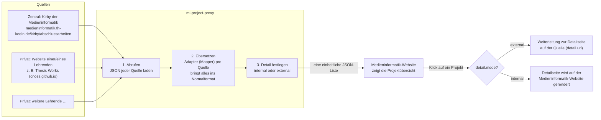

# mi-project-proxy

Schlanker PHP-Proxy-Endpunkt, der mehrere heterogene JSON-Quellen (z. B. GitLab APIs, Legacy-Systeme) abfragt, deren Daten über austauschbare Mapper-Klassen in ein einheitliches Normalformat transformiert und als konsolidiertes JSON ausliefert. Über Query-Parameter lässt sich die Ausgabe nach Quellen, Typ und Umfang filtern.

## Wie kommen die Projekte auf die Medieninformatik-Website?

Die Projekte liegen nicht auf der Website selbst, sondern in verschiedenen Quellen. Es gibt zwei Arten:

- **Zentrale Quelle:** das Kirby der Medieninformatik. Dort werden Arbeiten direkt gepflegt.
- **Private Quellen:** Viele Lehrende veröffentlichen die Arbeiten aus ihrer Betreuung schon auf der eigenen Website. Jede solche Seite kann eine Quelle sein, wenn sie die Daten als JSON anbietet. *Thesis Works* (cnoss.github.io) ist ein Beispiel dafür.

Jede Quelle liefert ihre Daten in einem eigenen Format. Der Proxy sammelt alles ein und macht daraus **eine** einheitliche Liste, die die Website direkt anzeigen kann.



In Worten:

1. **Abrufen:** Die Website fragt den Proxy. Der Proxy lädt das JSON aller Quellen aus [config/sources.php](config/sources.php).
2. **Übersetzen:** Für jede Quelle gibt es einen Adapter (im Code: Mapper), der deren Felder auf das gemeinsame Format abbildet. Aus `firstname` + `lastname` (Kirby) wird z. B. `author`, genau wie bei Thesis Works. Eine Quelle muss also nicht das „richtige" Schema liefern. Weicht ihr Format ab, schreibt man einfach einen passenden Adapter dazu.
3. **Detail festlegen:** Der Proxy entscheidet pro Projekt, wo die Detailseite liegt, und schreibt das Ergebnis in `detail.mode`.
4. **Anzeigen:** Die Website zeigt die Liste als Übersicht. Beim Klick auf ein Projekt reicht ein Blick auf `detail.mode`:
   - `external`: Die Quelle hat eine eigene Detailseite (typisch für private Quellen), die Website verlinkt dorthin.
   - `internal`: Die Quelle hat keine eigene Detailseite (z. B. Kirby), also rendert die Website sie selbst aus den Projektdaten.

Eine neue Quelle anbinden, z. B. die Website einer weiteren Lehrperson, heißt also nur:

1. Eintrag in [config/sources.php](config/sources.php) (URL des JSON und Adapter).
2. Liefert die Quelle schon das Format einer bestehenden Quelle, wird deren Adapter wiederverwendet. Sonst schreibt man einen neuen (siehe [Mapper schreiben](#mapper-schreiben)).

## Start (lokal)

```bash
php -S localhost:8080 -t public
```

Dann:

- `http://localhost:8080/index.php` (alle Sources)
- `http://localhost:8080/index.php?sources=gitlab-main,legacy-system&limit=25`
- `http://localhost:8080/index.php?type=gitlab&limit=50`
- `http://localhost:8080/index.php?raw=1` (inkl. `raw` Feld pro Projekt)

## Sources konfigurieren

Siehe [config/sources.php](config/sources.php).

Jede Source hat:

- `url`: JSON-Endpoint
- `mapper`: Mapper-Klasse
- `detail` (optional, Standard `auto`): wo die Detailseite eines Projekts gerendert wird
  - `auto`: Liefert der Mapper eine Detailseiten-URL, wird extern verlinkt, sonst intern gerendert
  - `internal`: immer auf dem Medieninformatik-Server rendern
  - `external`: immer auf die Quelle verlinken (fehlt die URL, wird intern gerendert)

### Detailseiten im Frontend

Jedes Projekt enthält ein aufgelöstes `detail`-Objekt. `auto` taucht dort nie auf, `mode` ist immer `internal` oder `external`:

```json
"detail": { "mode": "external", "url": "https://cnoss.github.io/thesis/…" }
"detail": { "mode": "internal", "url": null }
```

- `external`: auf `detail.url` verlinken (Detailseite liegt auf dem Source-Server)
- `internal`: eigene Detailseite rendern, identifiziert über `source` + `id`

## Mapper schreiben

Implementiere `Mi\\ProjectProxy\\Mapper\\MapperInterface` und trage die Klasse in [config/sources.php](config/sources.php) ein.

Der Mapper bekommt das bereits decodierte JSON (`mixed`) und gibt eine Liste normalisierter Projekte zurück.

Empfohlenes Normalformat pro Projekt:

- `id` (string|int|null)
- `name` (string)
- `type` (string|null)
- `url` (string|null)
- `detailUrl` (string|null): URL einer HTML-Detailseite auf dem Source-Server (keine PDF o. Ä.); wird vom Proxy in `detail` überführt
- `updatedAt` (string|null)
- `source` (string)
- optional `raw` (mixed/array)
